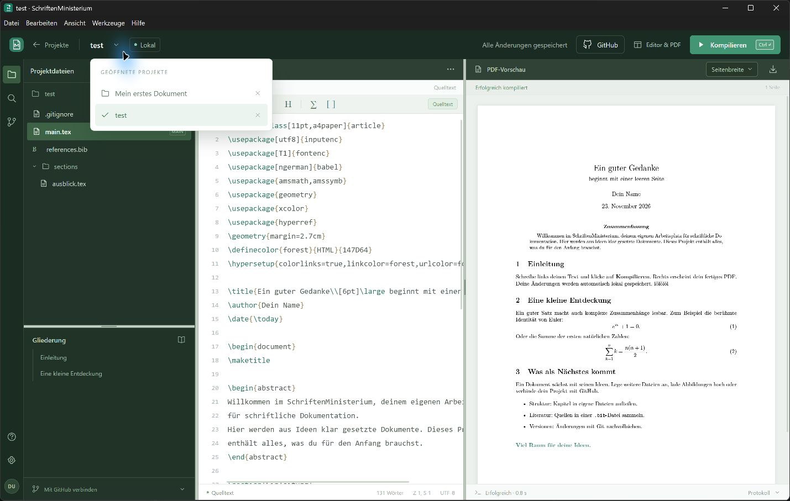
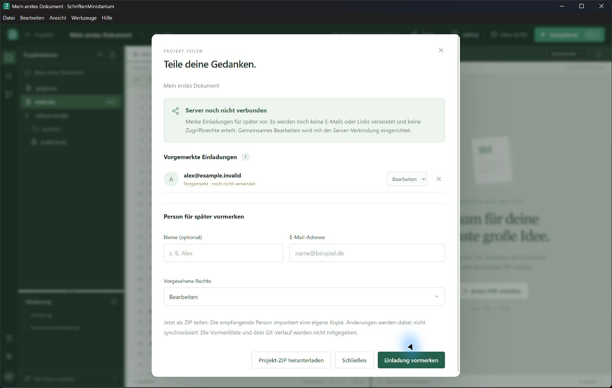

# SchriftenMinisterium

Dein Arbeitsplatz für schriftliche Dokumentationi.

Eine lokale Anwendung zum Organisieren, Schreiben und Erstellen von PDF-Dokumenten. Projekte und Einstellungen bleiben auf deinem PC. Externe Dienste werden nur über eine von dir eingerichtete Verbindung genutzt.

## Windows installieren

Die fertige Desktop-Ausgabe liegt unter **release/SchriftenMinisterium-Setup-0.3.0-x64.exe** und als Download in den [GitHub Releases](https://github.com/Kurzhaardackel69/SchriftenMinisterium/releases). Der Installer richtet die Anwendung für das aktuelle Windows-Konto ein und bietet Desktop- und Startmenü-Verknüpfungen an. Die Anwendung hat ein eigenes Fenster; ein Browser oder ein separates Serverfenster ist für die Benutzung nicht erforderlich. Die Programmdatei ist derzeit nicht mit einem kommerziellen Code-Signing-Zertifikat signiert.

Node.js und der Standard-PDF-Compiler sind im Desktop-Paket enthalten. Git bleibt optional und wird für die GitHub-Funktionen separat benötigt. Der Datenordner liegt bei der installierten Anwendung unter **%APPDATA%/SchriftenMinisterium/projects**; er bleibt bei der Deinstallation erhalten.



Vorhandene Projekte aus der bisherigen lokalen Version werden über **Datei → Vorhandene Projekte übernehmen** importiert: Wähle den bisherigen **data**-Ordner. Bereits vorhandene Projekt-IDs werden übersprungen und die Originaldateien bleiben erhalten. **Datei → Datenordner öffnen** zeigt den aktuellen Speicherort.

Für die Entwicklung startet **node server.mjs** weiterhin den lokalen HTTP-Dienst. **npm run desktop** startet die Desktop-Oberfläche nach Einrichtung der Bauwerkzeuge. Änderungen am Quelltext werden über GitHub verwaltet; historische Installer gehören in GitHub Releases.

## Installierte Anwendung aktualisieren

Ab Version **0.3.0** steht im nativen Menü **Hilfe → Nach Updates suchen** zur Verfügung. Die Prüfung erfolgt erst nach deinem Klick und liest ausschließlich stabile Releases dieses Anwendungs-Repositorys. Nach deiner Auswahl lädt die Anwendung den neuen Windows-Installer, prüft Dateigröße und den von GitHub bereitgestellten SHA-256-Wert und bietet **Jetzt aktualisieren und neu starten** an. Offene Dokumentänderungen werden vor dem Start des Updates gespeichert; bei einem Speicherfehler oder einer laufenden Projektaktion wird der Start abgebrochen.

Das Update ersetzt die vorhandenen Programmdateien am bisherigen Installationsort. Es ist keine vorherige Deinstallation und keine erneute Projekteinrichtung nötig. Die Anwendungskennung bleibt unverändert und der getrennte Datenordner im Benutzerprofil bleibt erhalten. Nach dem Update startet die Anwendung erneut. Geladene Update-Dateien werden beim nächsten Programmstart aus dem eigenen Update-Cache entfernt; Dokumentprojekte gehören nie zu diesem Cache.

**Einmaliger Übergang von 0.2.0:** Diese Version besitzt noch kein Update-Menü. Führe den aktuellen Installer einmal über die bestehende Installation aus. Danach verwendest du das Update-Menü. Falls du noch keine Ausgabe installiert hast, installierst du direkt 0.3.0. Eine Änderung am Quellcode allein ist noch keine veröffentlichte Desktop-Version; neue installierbare Stände werden zusätzlich als GitHub Release bereitgestellt.

Die Update-Prüfung nutzt HTTPS und den GitHub-Prüfwert. Dies ist keine Authenticode-Signatur. Ein fehlender oder abweichender Prüfwert verhindert den Update-Start. Die vollständige Aktualisierung einer vorhandenen Windows-Installation wurde auf diesem Entwicklungs-PC nicht automatisch ausgeführt; geprüft werden Erkennung, Download, Integrität, Desktop-Menü und Paketstart.

## Projekte und Dokumente

- Startseite mit Suche, Sortierung, Favoriten, Archiv und farbigen Tags.
- Ein Projektklick öffnet den Editor mit Dateibaum, mehreren Dateireitern, Gliederung und PDF-Vorschau.
- Automatisches Speichern, Syntaxfarben, Suche, Einrückung und Dokumentwerkzeuge.
- Layoutwahl zwischen Editor und PDF, nur Editor oder nur PDF. Dateibereich, Gliederung, Editor/PDF-Aufteilung und Protokoll lassen sich per Maus oder Pfeiltasten an den Trennleisten verstellen; Doppelklick setzt die jeweilige Größe zurück.
- Der Projektname öffnet ein kompaktes Dropdown ausschließlich mit geöffneten Projekten. Der separate Projekte-Knopf führt zur Übersicht.
- PDF-Erzeugung, Download, Protokoll und optional automatische Kompilierung.
- Artikelvorlage, leeres Dokument und Import eigener Projekt-ZIPs.
- Optionales Klonen, Committen, Pull und Push über GitHub.
- ZIP-Export mit sämtlichen Quelldateien, auch nicht committeten Dateien.

Unterstützt werden Quelltextprojekte mit einer `.tex`-Hauptdatei, Literaturdateien, eigenen Stildateien und eingebundenen Bildern. Die Hauptdatei lässt sich in den Projekteinstellungen oder über das Datei-Menü ändern. Umbenannte Dateien erfordern gegebenenfalls auch die Anpassung der Verweise im Quelltext.

## Tags und Organisation

Über das Plus neben **Deine Tags** werden Tags angelegt. Zur Farbauswahl stehen **Grün, Tannengrün, Blau, Türkis, Violett, Rosa, Rot, Orange, Gold und Grau** bereit. Zusätzlich bleibt eine freie Farbauswahl verfügbar. Die Auswahl gilt beim Erstellen und Bearbeiten von Tags und lässt sich mit der Tastatur bedienen.

Tags in der Projekttabelle zuweisen und über die Seitenleiste danach filtern. Sterne markieren Favoriten. Im Projektmenü lassen sich Name, Tags, Favoriten und Archivstatus ändern. Über Checkboxen können mehrere Projekte gemeinsam organisiert werden.

Archivierte Projekte bleiben vollständig erhalten. Sie können im Archiv wiederhergestellt werden. Tags und Projektorganisation liegen im lokalen Datenordner und werden nicht in das Git-Repository des Dokuments geschrieben.

## Eigene Vorlagen importieren

1. Unter **Importieren → Quelltext-ZIP** den Projektnamen eingeben.
2. Das vollständige ZIP auswählen oder ablegen.
3. Die Hauptdatei wird anhand von `\documentclass` erkannt; danach öffnet sich das Projekt im Editor.

Unterordner, Bilder, Literatur-, Stil- und Lizenzdateien bleiben erhalten. Ein einzelnes PDF enthält keinen bearbeitbaren Quelltext. Die Quelldateien werden beim Import nicht automatisch umgeschrieben. Ein erfolgreicher Import garantiert noch keine Kompilierung: Die benötigten Pakete und Werkzeuge müssen zur lokalen PDF-Erzeugung passen.

Importgrenzen: 25 MB ZIP, 100 MB entpackt, 30 MB pro Datei und 3.000 ZIP-Einträge. Passwortgeschützte Archive, symbolische Links, ZIP64, doppelte Dateinamen und Dateinamen ohne UTF-8 werden abgelehnt. Ein gemeinsamer äußerer ZIP-Ordner wird entfernt.

## Projekte teilen und Einladungen vorbereiten

Im Editor öffnet **Teilen** den Freigabe-Dialog; dieselbe Funktion ist in der Projektübersicht unter **Projekt verwalten → Teilen** erreichbar. **Projekt-ZIP herunterladen** gibt den aktuellen Quelltext als unabhängige Kopie weiter. Empfänger importieren das ZIP in ihrer Anwendung; Änderungen der Kopien werden nicht automatisch synchronisiert.

Für den späteren Serverbetrieb können Personen mit Name, E-Mail-Adresse und den vorgesehenen Rechten **Lesen** oder **Bearbeiten** vorgemerkt werden. Vorgesehene Rechte können geändert und Vormerkungen entfernt werden. Jede Vormerkung ist ausdrücklich als **noch nicht versendet** gekennzeichnet. Ohne Server-Verbindung gibt es keine aktiven Einladungslinks, keinen Versand und keine erteilten Netzwerk-Zugriffsrechte. Der spätere Server muss Konten, Anmeldung, Rechteprüfung und gemeinsames Bearbeiten ergänzen; die Vormerkungen werden nicht automatisch versendet.

Die Vormerkliste liegt lokal in **<Projekt-ID>/sharing.json**, getrennt von den Quelldateien. Sie wird weder im Projekt-ZIP noch bei Git-Commits des Dokuments weitergegeben. Bei einer Sicherung des gesamten Datenordners ist sie enthalten.




## Optionale GitHub-Verbindung

**Bestehendes Repository:** Importieren → GitHub wählen, URL und Projektnamen eingeben.

**Neues Projekt verbinden:** Ein leeres Ziel-Repository auf GitHub anlegen, im Editor GitHub öffnen und die Repository-URL eintragen. Bei Bedarf Commit-Name und E-Mail nur für dieses Projekt setzen. Dann Änderungen committen und mit Push übertragen.

Unterstützte URLs:

```text
https://github.com/name/projekt.git
git@github.com:name/projekt.git
```

Git nutzt deine lokale Anmeldung über Git Credential Manager oder einen bereits eingerichteten SSH-Schlüssel. SchriftenMinisterium speichert keine GitHub-Tokens. Erst deine Auswahl richtet eine Verbindung ein; Push und Pull werden durch deinen Klick ausgelöst.

Pull verwendet ausschließlich Fast-Forward-Updates. Bei auseinanderlaufenden Branches muss der Konflikt im Projektordner mit Git gelöst werden. Vor Pull lokale Änderungen committen. Force-Push wird nicht angeboten.

## Tastenkürzel

| Aktion | Tastenkürzel |
| --- | --- |
| Speichern | Strg+S |
| Kompilieren | Strg+Enter |
| Im Dokument suchen | Strg+F |
| Projekte durchsuchen | Strg+K |
| Einrücken | Tab |
| Auswahl ausrücken | Umschalt+Tab |
| Kommentar umschalten | Strg+/ |

Auf macOS kann für die Strg-Befehle auch Cmd verwendet werden.

## Dateien und Sicherung

```text
data/
  library.json        Tags und Farben
  <Projekt-ID>/
    project.json      Projektname, Hauptdatei und Organisation
    sharing.json      Lokal vorgemerkte Einladungen (optional)
    files/            Deine Quelldateien und ggf. Git-Verlauf
    build/            Letztes erfolgreiches PDF und Protokoll
  tex-cache/          Paketcache für die lokale PDF-Erzeugung
```

Für eine vollständige Sicherung den gesamten **data-Ordner bei beendeter Anwendung kopieren**. Ein Projekt-ZIP enthält die Quelldateien, aber keinen Git-Verlauf, keine Projektmetadaten und keine Build-Ausgaben. GitHub sichert ausschließlich committete und gepushte Dateien.

Die Oberfläche lädt keine externen Schriften, Skripte oder Analysedienste. Die Standard-PDF-Erzeugung kann beim ersten Durchlauf benötigte Satzpakete herunterladen und danach aus dem Cache verwenden. Die manuell gestartete Desktop-Update-Prüfung ruft GitHub ab; dabei werden keine Dokumentinhalte oder Vormerkliste übertragen.

Weitere Grenzen: 2 MB pro bearbeitbarer Textdatei, 10 MB pro Einzelupload, 100 MB pro Kompilierung/Export und drei Minuten pro Standard-Kompilierung beziehungsweise zehn Minuten für die gesamte vollständige Werkzeugkette. Nur ein Server darf denselben Datenordner verwenden. Externe Programmausführung ist standardmäßig ausgeschaltet. Bei einem vollständigen Compiler kann sie für vertrauenswürdige eigene Projekte explizit aktiviert werden. Der mitgelieferte Standard-Compiler läuft weiterhin ohne Shell-Escape. Dies ersetzt keine vollständige Betriebssystem-Sandbox.

## Compiler und Pakete

Die Desktop-Ausgabe enthält Tectonic als Standard-Compiler. Dieser eignet sich für viele Quelltextprojekte, ersetzt aber keine vollständige TeX-Distribution. Eine pauschale Zusage für alle Pakete, Schriftarten und Vorlagen ist nicht möglich.

Eine separat installierte **TeX Live**- oder **MiKTeX**-Distribution kann über die Projekteinstellungen verwendet werden. Wählbar sind **pdfLaTeX**, **XeLaTeX** und **LuaLaTeX**. Die Anwendung sucht die Programme im PATH und in üblichen Windows-Installationsordnern. Ein anderer Programmordner lässt sich in den Projekteinstellungen oder unter **Werkzeuge → TeX-Programmordner auswählen** angeben.

Bei vollständigen Compilern werden anhand der erzeugten Hilfsdateien **Biber oder BibTeX**, **makeglossaries** und **makeindex** für Literatur, Glossare, Register und Nomenklatur aufgerufen. Anschließend folgen weitere Satzdurchläufe. Benötigte Zusatzprogramme müssen in der Distribution installiert sein. Fehlende Werkzeuge werden im Protokoll genannt. Projektspezifische Skripte und beliebige Build-Konfigurationen werden nicht automatisch ausgeführt.

Für Pakete mit externen Programmen, beispielsweise zur SVG-Konvertierung oder Code-Hervorhebung, müssen diese Programme ebenfalls installiert sein. Shell-Escape muss gegebenenfalls bewusst pro Projekt aktiviert werden. Unterschiedliche Paketversionen, eigene Schriften und ältere Vorlagen können weiterhin Anpassungen erfordern. Import, verfügbare Werkzeuge und erfolgreiche Kompilierung sind getrennte Prüfungen.

## Konfiguration und späterer Serverbetrieb

| Variable | Standard | Bedeutung |
| --- | --- | --- |
| PORT | 3210 | Port des Entwicklungsservers |
| SCHRIFTENMINISTERIUM_DATA | data neben dem Server; im Desktop Benutzerprofil | Separater Datenordner |
| TECTONIC_PATH | tectonic; im Desktop mitgelieferte Programmdatei | Standard-Compiler |
| TECTONIC_CACHE_DIR | data/tex-cache | Paketcache |
| SCHRIFTENMINISTERIUM_TEX_BIN | automatisch | Programmordner einer vollständigen Distribution |

Oberfläche und HTTP-Server bleiben getrennt. In der Desktop-App läuft der Dienst intern auf der lokalen Loopback-Schnittstelle. Die aktuelle Anwendung hat keine Benutzerkonten oder gleichzeitige Bearbeitung. Für den späteren Serverbetrieb mit Freunden sind Anmeldung, Projektzugriffsrechte, HTTPS, isolierte Compiler-Prozesse und eine Strategie für gleichzeitige Änderungen erforderlich.

## Lizenzen

Der eigene Anwendungscode steht unter der beigefügten MIT-Lizenz. Fremdkomponenten behalten ihre jeweiligen Lizenzen. Hinweise und vollständige Texte liegen in **THIRD_PARTY_NOTICES.md**, unter **public/vendor/pdfjs/** sowie im installierten Programmverzeichnis und unter **resources/runtime/**. Zusätzlich installierte Programme, Vorlagen, Schriften und Bilder behalten ihre eigenen Lizenzbedingungen.

## Entwickeln und prüfen

Die Quelle ist mit Node.js ab Version 22 verwendbar. Die lokal bereitgestellten Bauwerkzeuge benötigen Node.js 24 oder neuer. Einrichtung und Windows-Build:

```sh
node scripts/bootstrap-build.mjs
node scripts/prepare-desktop.mjs
node scripts/build-desktop.mjs
```

Die Skripte beziehen festgelegte offizielle Versionen. Die Prüfsummen für Paketmanager und PDF-Compiler werden vor der Verwendung kontrolliert. **package-lock.json** fixiert die Entwicklungsabhängigkeiten.

```sh
node --test test/*.test.mjs
```

Die Integrationstests verwenden temporäre Projekte. Sie prüfen Projektverwaltung, Organisation, ZIP-Import, Pfadgrenzen, lokale API, Export und Git-Commits. Mit **SCHRIFTENMINISTERIUM_TEST_TEX=1** werden echte Standard-PDF-Erzeugung und der Erhalt des letzten guten PDFs nach einem Fehler geprüft. Die Ablaufsteuerung zusätzlicher Compilerwerkzeuge wird mit isolierten Werkzeug-Stubs geprüft; dies ersetzt keinen Test mit einer tatsächlich installierten vollständigen Distribution.

Gemäß **AGENTS.md** werden geprüfte Änderungen nach GitHub übertragen. Lokal werden nur der aktuelle Quellcode, die notwendigen Git-Metadaten und der neueste Installer behalten. Dokumentprojekte im **data**-Ordner werden nicht committet und bei der Bereinigung erhalten.
